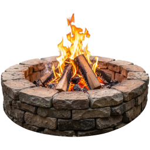

<div align="center">



# Inferno Bin

**A realistic burning fire pit for your Windows desktop.**
Drag any file or folder onto the fire, and it burns away.

[](https://github.com/Mohammed-El-Shayeb/InfernoBin/releases/latest)


</div>

## Download

1. Go to the **[latest release](https://github.com/Mohammed-El-Shayeb/InfernoBin/releases/latest)**.
2. Download **`InfernoBin.exe`**.
3. Double-click it. That's it: no installation, no Python, no extra files.

> **First launch:** Windows SmartScreen may show *"Windows protected your PC"* because the app is new and not code-signed.
> Click **More info** → **Run anyway**. You only need to do this once.

## Features

- **Real fire pit:** a photographic stone fire pit with living, animated flames, rising sparks, smoke, and firelight that flickers across the stones.
- **Drag, drop, burn:** drop any file or folder onto the fire. Sheets of paper fall in, char, and the fire flares up. No confirmation prompts.
- **Responsive fire:** the flames grow when you hover, roar when you drag a file over them, and burst when you drop it.
- **Real crackling sound:** a seamless fire-crackle loop that gets louder as the fire grows, with mute and volume controls.
- **Safe by default:** files go to the **Recycle Bin**, so you can restore anything. An optional *Burn permanently* mode is available.
- **System protection:** drive roots, Windows, Program Files, your user folder, Desktop, Documents, and other critical locations are refused.
- **Desktop widget:** transparent and frameless, stays on top, can be moved anywhere, and remembers its position.
- **Personalization:** three sizes, Arabic and English interface, tray icon, *Start with Windows*, and a burn log.
- **Smooth:** files are deleted in the background, so even huge folders never freeze the fire.

## How to use

| Action | Result |
|---|---|
| Drag a file or folder onto the fire | Burns it 🔥 |
| Left-click and drag the fire pit | Moves it |
| Right-click | Settings menu |
| Double-click | Opens the Recycle Bin |

**Settings menu:** delete mode · confirm before burning · always on top · size · fire sound · volume · start with Windows · language · burn log · about.

Settings and the burn log are stored in `%APPDATA%\InfernoBin`.

## Build from source

Requires **Python 3.10+** on Windows.

```bash
pip install -r requirements.txt
python inferno_bin.py
```

To build the standalone `InfernoBin.exe`, run `build_windows.bat`. The file is created in `dist\`.

Every push to `main` that changes the app builds and publishes a new release automatically through GitHub Actions.

## Author

**Mohammed El-Shayeb (محمد الشايب)**, Computer Vision & AI Engineer

[LinkedIn](https://www.linkedin.com/in/mohammed-el-shayeb) · mohammed.el.shayeb.ai@gmail.com

© 2026 Mohammed El-Shayeb. All rights reserved.
