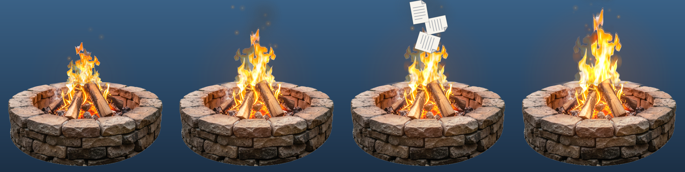

# 🔥 Inferno Bin

**سلة مهملات مشتعلة كلاسيكية لسطح المكتب** — اسحب أي ملف أو مجلد عليها بالماوس فيحترق.

> Designed & Developed by **Mohammed El-Shayeb (محمد الشايب)** — Computer Vision & AI Engineer
> © 2026 Mohammed El-Shayeb. All rights reserved.

## ⬇️ التحميل / Download
**[حمّل InfernoBin.exe من هنا](https://github.com/Mohammed-El-Shayeb/InfernoBin/releases/latest)** — ملف واحد، دبل كليك ويشتغل، بدون تثبيت وبدون Python.

> أول تشغيل قد يظهر تحذير Windows الأزرق: اضغط **More info** ← **Run anyway**.

## المزايا
- موقد حجري حقيقي (صورة مفرّغة) مع نار حيّة متحركة وشرر ودخان، والحجارة تضيء بلهب النار.
- النار مشتعلة دائماً بهدوء، وتكبر عند مرور الماوس، وأكثر عند سحب ملف فوقها، والحرق فوري بدون أي سؤال: تسقط أوراق في السلة وتحترق وتشتعل النار.
- **وضعان للحذف:** إلى سلة المحذوفات (آمن، الافتراضي) أو حرق نهائي.
- حماية من حذف مسارات النظام (جذر القرص، Windows، Program Files، مجلد المستخدم، سطح المكتب...).
- نافذة شفافة بلا إطار، فوق كل النوافذ، ويمكن تحريكها بالسحب، وتحفظ مكانها.
- صوت طقطقة نار حقيقي متواصل بدون انقطاع (يعلو مع اشتداد النار)، مع زر كتم ومستوى صوت.
- ثلاثة أحجام، وواجهة عربي/إنجليزي، وأيقونة في شريط المهام، وسجل للمحروقات.
- خيار التشغيل مع بدء ويندوز، ونقرة مزدوجة تفتح سلة المحذوفات.
- الحذف يعمل في الخلفية فلا تتجمد الواجهة مع المجلدات الكبيرة.

## التشغيل
1. ثبّت Python من https://www.python.org/downloads/ مع تفعيل خيار **Add python.exe to PATH**.
2. فك الضغط ثم دبل كليك على **`start.bat`**: يثبّت المكتبات تلقائياً ويشغّل السلة أسفل يمين الشاشة.
3. أي خطأ يظهر في رسالة ويُحفظ في `%APPDATA%\InfernoBin\error_log.txt`.

## بناء ملف ‎.exe‎ (على ويندوز)
شغّل `build_windows.bat` ← الناتج `dist\InfernoBin.exe`
خصائص الملف (Properties → Details) تحمل اسمك كمطوّر وصاحب الحقوق.

## الاستخدام
| الحركة | الوظيفة |
|---|---|
| سحب ملف/مجلد وإفلاته على السلة | حرق 🔥 |
| سحب السلة بالزر الأيسر | تحريكها |
| زر أيمن | القائمة والإعدادات |
| نقرة مزدوجة | فتح سلة المحذوفات |

الإعدادات والسجل محفوظة في `%APPDATA%\InfernoBin`.
